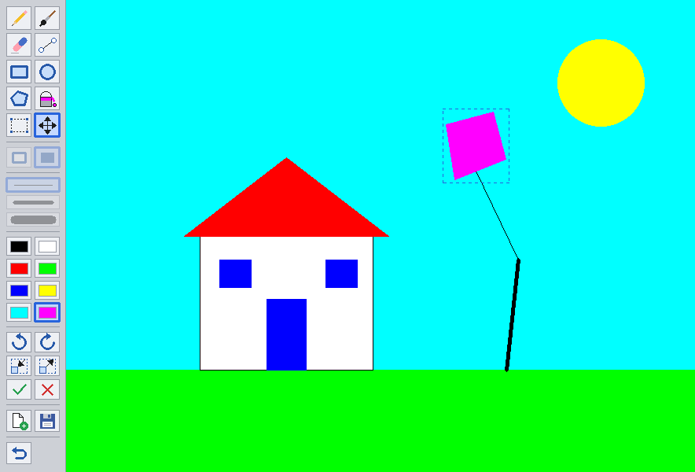

# Trabalho 1: Mini Paint

Sistema de desenho 2D interativo em Python. Todo desenho passa por um framebuffer próprio e pelos nossos algoritmos de rasterização. GLFW e OpenGL só abrem a janela e mostram o framebuffer na tela com `glDrawPixels`.



## Como rodar

Precisa do Python 3.11 ou mais novo.

```bash
cd miniPaint
python3 -m venv .venv
source .venv/bin/activate        # no Windows: .venv\Scripts\activate
pip install -r requirements.txt
python main.py
```

No Windows, use `python` no lugar de `python3`.

## Como usar

### Ferramentas

| Ferramenta | Tecla | Como usar |
|---|---|---|
| Lápis | P | Traço livre de 1 pixel |
| Pincel | I | Traço livre na espessura escolhida |
| Borracha | B | Apaga pintando com a cor de fundo |
| Linha | L | Clique no começo e arraste até o fim |
| Retângulo | R | Arraste de um canto ao outro |
| Círculo | C | Clique no centro e arraste até a borda |
| Polígono | G | Clique em cada vértice e feche clicando no primeiro ponto ou com Enter |
| Balde | F | Pinta a região da mesma cor em volta do clique |
| Selecionar | A | Arraste um retângulo pra descolar aquele pedaço do desenho |
| Mover | M | Arraste a forma ou a área selecionada |

A barra também tem as 8 cores, as espessuras fina, média e grossa (teclas 1, 2 e 3) e a opção vazado ou preenchido (V) pro retângulo, o círculo e o polígono. Quando uma opção não vale pra ferramenta atual, o botão dela fica apagado, e o título da janela explica o motivo.

### Forma selecionada

Linha, retângulo, círculo, polígono e área selecionada ficam soltos por cima do desenho, com uma moldura tracejada, até serem fixados. Enquanto isso:

| Ação | Como |
|---|---|
| Mover | Ferramenta Mover ou setas (Shift + seta anda 1 pixel) |
| Girar 15° | Q e E |
| Mudar o tamanho em 10% | + e − |
| Fixar no desenho | Enter, começar outro desenho ou trocar de ferramenta |
| Jogar fora | Delete |

Trocar a cor, a espessura ou o preenchimento com a forma selecionada muda a própria forma.

### Outros comandos

| Comando | Tecla |
|---|---|
| Novo | N |
| Salvar em BMP, na pasta `desenhos/` | S |
| Desfazer | Ctrl+Z (Cmd+Z no Mac) |
| Sair | Esc |

## Onde está cada requisito

| Requisito | Onde |
|---|---|
| Canvas de 800x600 | `main.py`, `CANVAS_WIDTH` e `CANVAS_HEIGHT` |
| `put_pixel` e `get_pixel` | `framebuffer.py` |
| Linha com Bresenham | `raster.py`, `bresenham_line` |
| Círculo pelo ponto médio | `raster.py`, `circle_octant` e `circle_points` |
| Retângulo e polígono, vazados e preenchidos | `raster.py`, `draw_polygon` e `fill_polygon` (varredura de linhas) |
| Balde com pilha e 4 vizinhos | `fill.py`, `flood_fill` |
| Mouse: clique, arrasto e soltar | `main.py`, `on_mouse_button` e `on_cursor_move`; cada ferramenta de `tools.py` tem `press`, `drag` e `release` |
| Estrutura de dados | `shapes.py`: cada forma é uma lista de pontos com seu estilo |
| Translação, rotação e escala | `transform.py`: matrizes 3x3 em coordenadas homogêneas |
| Paleta, espessura, Novo e Salvar | `ui.py` e `bmp.py` |
| Cores RGB e blend | `framebuffer.py`, `blend`, usado nos botões apagados da barra |

## Organização do código

| Arquivo | O que tem |
|---|---|
| `main.py` | Janela, loop principal, mouse e teclado, forma selecionada e desfazer |
| `framebuffer.py` | A matriz de pixels e as funções que mexem nela |
| `raster.py` | Algoritmos de rasterização |
| `fill.py` | Balde |
| `transform.py` | Matrizes de transformação |
| `shapes.py` | Formas como objetos e o pedaço de imagem da seleção de área |
| `tools.py` | Ferramentas |
| `ui.py` | Barra de ferramentas e ícones |
| `bmp.py` | Gravação do arquivo BMP |

## Decisões que vale saber

- **`put_span` e `put_image`.** Pintar um trecho horizontal ou colar uma imagem já calculada de uma vez dá no mesmo que chamar `put_pixel` em cada ponto. Quem decide quais pixels pintar continua sendo o nosso algoritmo. Sem isso, a prévia de um retângulo cheio grande levava uns 100 ms por quadro.
- **Balde com 4 vizinhos.** As linhas de Bresenham andam na diagonal. Com 8 vizinhos, a tinta escaparia entre dois pixels da diagonal.
- **Lápis sempre com 1 pixel,** como pede o enunciado. Quem usa a espessura é o pincel.
- **Matriz de rotação.** Seguimos a convenção dos slides, com o ponto como a linha `[x y 1]` antes da matriz. Nessa convenção, a matriz de rotação é a transposta da que aparece no slide 15. Com ela, o exemplo do slide 9 confere: (6, 1) girado 30° dá (4,7; 3,9).
- **Girar e escalar pixels.** Pra cada pixel do destino, a matriz inversa diz de qual pixel original ele veio (mapeamento inverso com vizinho mais próximo). Assim não ficam buracos. Como o pedaço sempre parte dos pixels originais, girar várias vezes não borra a imagem.
- **Polígono preenchido** segue a regra do par ou ímpar: numa estrela que cruza as próprias arestas, o miolo fica vazio.
- **Tabela do círculo no slide.** O exemplo de raio 10 diverge do código do mesmo slide a partir de x = 4. O código está certo e é ele que usamos.

## Grupo

- Matheus Medrado Ferreira
- Daniel Gentil
- Christian Silva
- Giovana Ferreira
