# Mini Paint: guia de apresentação

Documento leve pra quem vai **explicar o projeto** sem precisar decorar o código. Use junto com o [README](../README.md), que é a referência técnica, e com a captura [tela.png](tela.png). Os quatro diagramas deste guia ficam em [diagramas/](diagramas) como SVG e dá pra projetar direto.

**Disciplina:** GBC204 Computação Gráfica, UFU/FACOM, 2026-02  
**Trabalho 1:** sistema de desenho 2D interativo

**Grupo:** Matheus Medrado Ferreira · Daniel Gentil · Christian Silva · Giovana Ferreira

---

## Em 30 segundos

Construímos um **Mini Paint**, um programa de desenho 2D com mouse e teclado. Ele tem canvas de **800×600**, paleta de cores, espessuras, formas geométricas, balde de tinta, seleção de área e **transformações** (mover, girar e escalar).

A regra de ouro do trabalho é que **cada pixel que aparece na tela passou pelos nossos algoritmos**, que escrevem numa matriz de pixels nossa (`put_pixel` e `get_pixel` no `Framebuffer`). A **GLFW** só abre a janela e avisa mouse e teclado. O **OpenGL** só copia a imagem pronta pra janela com `glDrawPixels`. Não usamos nenhuma função pronta da GPU pra desenhar linha.

---

## O que mostrar ao vivo (roteiro de 8 a 12 min)

Sugestão de ordem. Cada pessoa pode ficar com um bloco, e a última coluna diz qual diagrama projetar.

| Quem | Bloco | O que fazer na tela | Diagrama |
|------|-------|---------------------|----------|
| 1 | Intro e arquitetura | Abrir o app, apontar a barra lateral e o canvas, dizer que tudo é matriz de pixels | [1](diagramas/1-modulos.svg) |
| 2 | Traço e formas | Lápis (1 px) e pincel (espessura), linha, retângulo vazado e preenchido, círculo | [2](diagramas/2-clique-ate-o-pixel.svg) |
| 3 | Polígono e balde | Polígono com vários cliques, fechar no primeiro ponto ou com Enter, balde numa região | [4](diagramas/4-algoritmos.svg) |
| 4 | Seleção e transformações | Selecionar (área azul translúcida), Mover, Q e E giram 15°, + e − mudam 10%, Enter fixa | [3](diagramas/3-forma-selecionada.svg) |
| 5 | Persistência | Novo (N), Salvar BMP (S) em `desenhos/`, Ctrl+Z, Esc duas vezes pra sair | |
| 6 | Código (1 slide ou terminal) | Mostrar `framebuffer.py`, `raster.py` e o `render` do `main.py`, citar Bresenham e flood fill | [2](diagramas/2-clique-ate-o-pixel.svg) e [4](diagramas/4-algoritmos.svg) |

**Figura pronta:** a casa, o sol e a pipa em [tela.png](tela.png) mostram uma forma selecionada, com a moldura tracejada. É um bom slide de extra além do mínimo.

---

## Como o programa "pensa"

Os dois primeiros diagramas dão a visão geral. Todo nome em fonte de código nas caixas existe no código com essa grafia, então dá pra achar com uma busca no arquivo.

### Diagrama 1: os módulos e quem chama quem



Linha cheia é uma chamada entre módulos. Com ponta nos dois lados, um chama o outro de volta. O `MiniPaint` cria a barra e as ferramentas, e os botões e o Mover chamam métodos do `MiniPaint`. Linha tracejada é alguém lendo ou escrevendo pixels no `Framebuffer`. Todas as tracejadas terminam no `framebuffer.py`, porque nenhum algoritmo pinta na janela.

Só o `main.py` fala com a GLFW e com o OpenGL. O OpenGL não desenha nenhuma forma. Ele só limpa a janela e copia a matriz pronta pra ela com `glDrawPixels`, em `MiniPaint.show`.

### Diagrama 2: do clique ao pixel na tela


O `MiniPaint` tem duas "telas" de pixels do tamanho do canvas:

- **`canvas`** é o desenho **fixo**, o que vai pro BMP e pro Ctrl+Z.
- **`screen`** é o que aparece na janela. A cada quadro ele começa como cópia do `canvas` e ganha por cima a forma **solta** (selecionada), a moldura tracejada e a **prévia** da ferramenta. A barra lateral tem um framebuffer só dela, mostrado à esquerda do `screen`.

Isso explica por que dá pra mover uma linha antes de fixar com Enter. Ela ainda não foi desenhada no `canvas`.

O laço de `MiniPaint.run` roda o tempo todo. No começo de cada volta, `glfw.poll_events` chama os callbacks dos eventos que chegaram, como `on_mouse_button` e `on_cursor_move`. Depois o `render` monta o `screen` e mostra na janela.

O Pincel, o Lápis e a Borracha pintam direto no `canvas`, no `press` e no `drag`. O Balde pinta no `press`. Linha, Retângulo, Círculo, Polígono e Selecionar só guardam pontos, e o que você vê enquanto arrasta é a prévia. Um clique na barra não chega na ferramenta. Quando o x é menor que `TOOLBAR_WIDTH`, o `on_mouse_button` manda o clique pro `Toolbar.click`.

---

## Mapa dos arquivos (quem explica o quê)

| Arquivo | Frase para a banca |
|---------|-------------------|
| `main.py` | Orquestra tudo: janela, loop, histórico do Ctrl+Z, forma solta, monta o `screen` e manda pro OpenGL. |
| `framebuffer.py` | Nossa "tela lógica": matriz NumPy RGB, `put_pixel`, `get_pixel`, trechos horizontais (`put_span`) e mistura de cor (`blend`). |
| `raster.py` | Geometria na mão: **Bresenham** (linha), **ponto médio** (círculo), retângulo e polígono (contorno e **varredura** pro preenchimento). |
| `fill.py` | **Flood fill** com **pilha** e **4 vizinhos** (não 8). |
| `transform.py` | Translação, rotação e escala com **matrizes 3×3** em coordenadas homogêneas, como nos slides. |
| `shapes.py` | Linha, polígono, círculo e **Patch** (recorte retangular da seleção) como objetos com pontos e estilo. |
| `tools.py` | Uma classe por ferramenta, com `press`, `drag` e `release`, mais a prévia e o `enter` e o `cancel` do polígono. |
| `ui.py` | Barra lateral desenhada num **framebuffer próprio** (`Toolbar.fb`). Os ícones também saem dos nossos algoritmos de rasterização. |
| `bmp.py` | Exportação **BMP escrita na mão**, sem biblioteca de imagem. |

---

## A vida de uma forma selecionada

### Diagrama 3: prévia, solta, fixada ou jogada fora



Linha, retângulo, círculo, polígono e área selecionada passam por esses estados. O pincel, o lápis, a borracha e o balde não passam, porque pintam direto no canvas.

Na prévia e enquanto está solta, a forma ainda não está no `canvas`. Ela é uma lista de pontos com estilo, desenhada no `screen` a cada quadro. Por isso dá pra mover, girar e escalar sem estragar o desenho embaixo. Cada transformação monta uma matriz em `transform.py`, e `Shape.transform` aplica essa matriz nos pontos. Os pontos guardam casas decimais, então girar várias vezes não acumula arredondamento.

Fixar chama `commit_selection`, que desenha a forma no `canvas`. Daí em diante ela vira pixels e não dá mais pra mexer nela como forma. Qualquer clique novo no canvas fixa a forma, até com a mesma ferramenta. A exceção é o Mover. Trocar pro Mover não fixa nada, e com ele só um clique fora da moldura fixa.

### Exemplo passo a passo: um retângulo

1. Você escolhe Retângulo (R) e aperta o mouse no canvas.
2. O `on_mouse_button` fixa a forma solta anterior, se houver, com `commit_selection`. Depois chama `remember`, que guarda uma cópia do canvas pro Ctrl+Z. Com o Mover ativo, nenhum dos dois acontece.
3. O `press`, o `drag` e o `release` do `RectTool` atualizam os cantos. A cada quadro, o `preview` desenha o retângulo provisório no `screen`.
4. Ao soltar, o `release` devolve um `Polygon` de 4 pontos e o `main.py` guarda esse objeto em `selection`. Ele ainda **não** está no `canvas`.
5. Você gira com Q ou E. O `rotate_selection` chama `Shape.transform` com `around(centro, rotation(...))`.
6. Enter, um novo clique no canvas ou a troca de ferramenta chamam `commit_selection`, que faz `selection.draw(canvas)`. Agora os pixels estão fixos.

O Selecionar segue a mesma lógica, mas o objeto é um **`Patch`**, com os pixels copiados do canvas. Ao soltar o mouse, o `SelectTool.release` já pinta o buraco com a cor de fundo. Se você apertar Delete, o buraco fica.

---

## Desfazer (Ctrl+Z)

Antes de cada clique que pode mudar o canvas, e antes do Novo, o `remember` guarda uma cópia do canvas (`canvas.snapshot()`), até **30** cópias. Uma cópia igual à anterior não é guardada.

O Ctrl+Z age em ordem:

1. Com um polígono aberto, ele só desiste do polígono.
2. Com uma forma solta, a forma some e o canvas volta pra cópia de antes do clique que a criou. No Selecionar, isso tapa o buraco.
3. Sem nada disso, o canvas volta pra última cópia diferente do que está na tela.

---

## Algoritmos que a disciplina pede

### Diagrama 4: onde cada algoritmo entra



À esquerda está quem chama. No meio ficam os algoritmos, agrupados pelo assunto dos slides. À direita estão os métodos do `Framebuffer` onde a pintura termina. As transformações não chegam lá, porque só mudam os pontos da forma. Depois a forma é desenhada pelas mesmas funções de reta, círculo e polígono.

O `put_span` e o `put_image` fazem o mesmo que chamar `put_pixel` em cada ponto de um trecho horizontal ou de uma imagem, só que de uma vez. Quem decide quais pixels pintar continua sendo o algoritmo.

### Linha: Bresenham (`raster.bresenham_line`)

- Usa só aritmética inteira. O parâmetro de decisão escolhe o próximo pixel sem calcular a equação da reta em cada passo.
- Nosso código generaliza o slide. O eixo que **mais varia** vira o eixo principal, então funciona pra reta de qualquer inclinação, não só as mais horizontais.

### Círculo: ponto médio (`circle_octant` e espelhamento)

- Calcula **um oitavo** do círculo e espelha nos outros sete (`circle_points`).
- O parâmetro de decisão `d` é o do slide. **Observação honesta:** em raio 10, a tabela do slide diverge do código do slide a partir de x = 4. **Seguimos o algoritmo**, que está certo, e não a tabela.

### Polígono preenchido: varredura de linhas (`fill_polygon`)

- Pra cada linha y, acha onde as arestas cruzam aquela altura e preenche entre os pares de cruzamentos.
- Cada aresta conta a ponta de cima e não a de baixo, pra um vértice não valer por dois.
- **Regra par ou ímpar:** numa forma que cruza as próprias arestas, como uma estrela, o miolo fica vazio. É o comportamento esperado.
- Depois de preencher, o `fill_polygon` passa o contorno com `draw_polygon`, então a borda sai pela Bresenham.

### Balde: flood fill (`fill.flood_fill`)

- Usa **pilha** (LIFO), não fila.
- **4 vizinhos**, só os retos. Com **8 vizinhos**, a tinta vazaria pelas diagonais das linhas finas da Bresenham.

### Transformações (`transform.py` e `shapes.py`)

- O ponto é a linha **[x y 1]** e vem antes da matriz, **[x' y' 1] = [x y 1] · M**, que é a convenção dos slides.
- Nessa convenção, a matriz de rotação é a **transposta** da que aparece no slide 15, que usa o ponto em coluna. Conferimos com o exemplo do slide 9: (6, 1) girado 30° dá (4,7; 3,9).
- O giro e a escala da forma solta usam `around`, que leva o centro pra origem, aplica a matriz e devolve pro lugar.
- **Girar e escalar a imagem (Patch):** mapeamento **inverso** (`inverse`). Pra cada pixel do destino, a matriz inversa diz de qual pixel original ele veio (vizinho mais próximo). Assim não ficam buracos, e girar várias vezes **não borra**, porque sempre lê do `source` original.

---

## Decisões do projeto

1. **O lápis tem sempre 1 pixel**, como pede o enunciado. O **pincel** usa a espessura, que é um disco de pixels.
2. **Forma solta** depois de linha, retângulo, círculo, polígono e seleção. Tudo isso dá pra mover, girar e escalar **antes** de fixar. Nas formas desenhadas também dá pra trocar cor, espessura e preenchimento, mas não na área selecionada, que é imagem. É um diferencial na demo.
3. **`put_span` e `put_image`** são otimização e **não trocam** o algoritmo. Eles só aplicam de uma vez os pixels que o algoritmo já decidiu. Sem isso, a prévia de um retângulo grande ficava lenta.
4. **A barra apaga as opções que não valem** pra ferramenta atual (blend com o fundo), e o **título da janela** explica o motivo, como o Balde não usar espessura.
5. **Esc duas vezes** pra sair, pra não fechar sem querer.
6. **Ctrl+Z com polígono aberto** primeiro desiste do polígono, sem mexer no desenho.
7. **Seleção de área** com prévia **azul translúcida** (`blend_rect` e `blend_span`), a mesma ideia do alfa dos slides.

---

## Como rodar no dia da apresentação

```bash
cd miniPaint
python3 -m venv .venv
source .venv/bin/activate    # Windows: .venv\Scripts\activate
pip install -r requirements.txt
python main.py
```

Precisa de **Python 3.11** ou mais novo. As dependências são GLFW, PyOpenGL e NumPy, com versões flexíveis no `requirements.txt`.

Salvar gera `desenhos/desenho-AAAAMMDD-HHMMSS.bmp`.

---

## Perguntas que costumam aparecer

| Pergunta | Resposta |
|----------|----------|
| O OpenGL desenha as linhas? | Não. Ele só exibe a matriz RGB com `glDrawPixels`. |
| Onde está a Bresenham? | Em `raster.py`, na função `bresenham_line`. |
| Por que flood fill com 4 vizinhos? | As diagonais furariam os contornos de 1 px da Bresenham. |
| Como funciona a rotação da seleção? | Matriz 3×3 nos pontos. Pra imagem, matriz inversa e o pixel de origem mais próximo. |
| Qual a estrutura de dados das formas? | Lista de pontos `(x, y)` com casas decimais e um `Style` (cor, espessura e preenchido). |
| Qual a diferença entre lápis e pincel? | O lápis pinta 1 pixel. O pincel pinta um disco de pixels em volta de cada ponto (`brush_offsets`). |
| Por que dá pra mexer na forma depois de desenhar? | Ela fica solta em `MiniPaint.selection` como lista de pontos e só vira pixel no `canvas` quando é fixada (diagrama 3). |
| As transformações pintam pixels? | Não. Elas só mudam os pontos da forma. Quem pinta é o `draw` da forma, com as funções de reta, círculo e polígono. |
| O que acontece com o buraco da seleção se eu apertar Delete? | O buraco fica, porque o `SelectTool.release` já pintou ele com a cor de fundo. O Ctrl+Z traz o canvas de volta. |
| Como é o BMP? | Escrito à mão em `bmp.py`. Cabeçalho de 54 bytes, linhas de baixo pra cima, cores na ordem azul, verde, vermelho e cada linha completada até um múltiplo de 4 bytes. |

---

## Divisão sugerida de falas

- **Christian:** visão geral, arquitetura, framebuffer vs GPU, roteiro do código. Diagramas 1 e 2.
- **Daniel:** ferramentas e interação (`tools.py`, mouse, forma solta) e algoritmos (`raster.py`, `fill.py`), com Bresenham, círculo, varredura e balde. Diagramas 3 e 4.
- **Giovana:** transformações, Patch, barra, BMP e decisões de UX (Esc, desfazer, título). Diagrama 3 e o bloco de transformações do diagrama 4.

Ajustem conforme quem se sentir mais à vontade em cada parte. O importante é **cobrir algoritmos, decisões e demo**.

---

## Como mudar um diagrama

Os arquivos `.mmd` em `diagramas/` são a fonte, em Mermaid. Os `.svg` são gerados a partir deles com o [Pele](https://pele.run) 1.9.0. Se mudar um `.mmd`, gere o `.svg` dele de novo.
